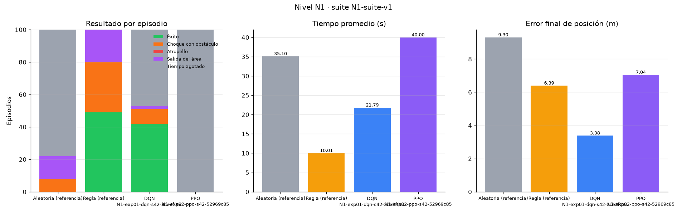
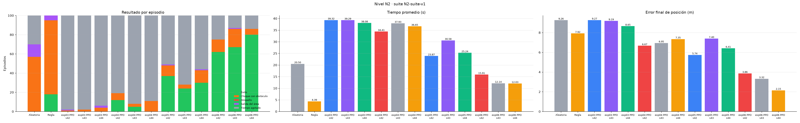

# AutoPark RL — Estacionamiento autónomo con aprendizaje por refuerzo

Proyecto final de MLOps (escenario **Autonomous Parking**). Un vehículo aprende a estacionarse en un
cupo de un parqueadero, evitando autos estacionados, columnas y bordillos. Incluye:

- **Ambiente Gymnasium** versionado (`parking-v4`) con física de bicicleta, sensores tipo LiDAR y
  colisiones exactas. Ver la [ficha del ambiente](docs/ficha_ambiente.md).
- **Niveles versionados** en `configs/levels/`, cada uno desarrollado en su rama `feature/nivel-N`.
- **Referencias** (aleatoria y por reglas) y agentes aprendidos: **PPO** (Stable-Baselines3), **DQN** y
  Q-learning tabular.
- **Pipeline** de entrenamiento que registra cada run en **MLflow** y empaqueta el modelo con su
  **manifiesto** (hashes SHA-256, commit, versión del ambiente, configuración y semilla).
- **Evaluación** con suites fijas y resultados por episodio. Ver el [registro de experimentos](docs/experimentos.md).
- **Visualización 3D** (Three.js) que carga cualquier modelo registrado del catálogo.



---

## Instalación

Requisitos: Python 3.12 (probado con 3.12.7) y un navegador moderno.

```bash
cd Parking
python3.12 -m venv .venv
.venv/bin/python -m pip install --upgrade pip
.venv/bin/python -m pip install -r requirements.lock.txt   # versiones exactas (macOS arm64)
```

En Windows use `.venv\Scripts\python.exe` en lugar de `.venv/bin/python`. `requirements.txt` lista las
dependencias directas; `requirements.lock.txt` fija las versiones exactas con que se generaron los modelos.
En macOS, PyTorch se instala desde PyPI; en Linux/Windows sin GPU puede usarse el índice CPU
(`--index-url https://download.pytorch.org/whl/cpu`) antes de instalar el resto.

Los comandos siguientes usan `.venv/bin/python` desde la carpeta `Parking/`.

## Uso rápido

```bash
.venv/bin/python run.py train configs/experiments/N1-exp01-dqn.json   # entrena y registra un experimento
.venv/bin/python run.py evaluate --level N1                           # compara referencias y modelos
.venv/bin/python run.py serve --level N1                              # http://127.0.0.1:8000
.venv/bin/python -m mlflow ui --backend-store-uri sqlite:///mlflow.db  # http://127.0.0.1:5000
```

### Experimentos y paquetes de modelos

Un experimento es un archivo JSON en `configs/experiments/` con su **hipótesis**, el cambio frente a la
referencia, el agente, la semilla, el presupuesto y los hiperparámetros. El pipeline
(`pipelines/train.py`) hace lo siguiente:

1. Resuelve la configuración (experimento + nivel + suite) y calcula su SHA-256.
2. Abre un run en MLflow con parámetros, commit, rama, versión del ambiente e hipótesis.
3. Entrena y registra por separado la curva de **entrenamiento** (con exploración) y la de
   **validación** (política congelada, semillas desde 200000).
4. Evalúa el modelo final con la suite del nivel (resultados por episodio).
5. Guarda el paquete en `artifacts/<nivel>/<run_id>/` (`model`, `config.json`, `curves.json`,
   `evaluation.json`, `manifest.json`) y el manifiesto en `manifests/<run_id>.json`.

Para repetir un experimento con otra semilla (réplicas): `run.py train <config> --seed 43`.
Opciones de PPO en el experimento: `parent_run_id` (continuar un checkpoint verificado de la misma familia
de observaciones), `hyperparameters.n_envs` (ambientes en paralelo) y `curriculum` (etapas más fáciles del
mismo nivel antes del nivel completo; ver `configs/experiments/N2-exp06-ppo-curriculo-3m.json`).

Si el entrenamiento falla, el run queda en MLflow y en `manifests/` con `status: "failed"`, su
diagnóstico y «sin checkpoint disponible». Al cargar un modelo (API, web o `demo`) se verifica que el
SHA-256 del archivo coincida con el del manifiesto.

### Evaluar

```bash
.venv/bin/python run.py evaluate --level N1
```

Usa la suite `configs/suites/<nivel>-suite-v1.json` y guarda en `results/<nivel>/`: `eval_<política>.json`
(resultado por episodio con causa de fallo, tiempo, error final y latencia), `comparison.json`,
`comparison.png` y `curves.png`.

**Test final reservado.** Sus semillas no están en el repo: viven en `~/.parking-rl/` (o en
`PARKING_SECRET_DIR`) y el repo solo guarda su huella SHA-256 en `configs/suites/<nivel>-final-v1.json`.
Se crea una vez y se usa una vez, con los modelos ya elegidos:

```bash
.venv/bin/python -m pipelines.evaluate --level N1 --new-final
.venv/bin/python -m pipelines.evaluate --level N1 --final <run_id> [<run_id> ...]   # → results/N1/final_test.json
```

### Ejecutar el ambiente

```bash
.venv/bin/python run.py demo --policy rule --level N1 --episodes 3 --verbose
.venv/bin/python run.py demo --policy N1-exp01-dqn-s42-3ce2f0ec   # un modelo registrado
```

```python
from envs.levels import make_env

env = make_env("N1")
obs, info = env.reset(seed=42)
obs, reward, terminated, truncated, info = env.step(0)  # 0 = avanzar
```

### Visualización 3D

```bash
.venv/bin/python run.py serve --level N1 [--port 8000] [--sensor-noise 0.1]
```

Abrir **http://127.0.0.1:8000**. En el panel se elige el nivel y el agente: aleatoria, regla o
cualquier modelo registrado, con su % de éxito en la suite. La barra superior indica el **modo**
(Aleatorio, Referencia, Evaluación con modelo congelado o Manual) y el panel muestra el commit, la
semilla y el hash del modelo activo. Con el agente **«Manual (teclado)»** se maneja con las flechas
(↑ avanzar, ↓ retroceder, ← → girar, F frenar) o con los botones en pantalla; el tiempo solo avanza
mientras se mantiene presionada una acción. «Entrenar DQN» lanza el pipeline real, así que ese entrenamiento
también queda registrado en MLflow y con manifiesto.

### Pruebas

```bash
.venv/bin/python -m pytest
```

---

## Controles de la interfaz

La escena es un garaje techado en tonos lila: piso pulido con reflejos, luces lineales y letrero
de neón con *bloom*, ventanales con la ciudad al atardecer, columnas "P1" y jardineras.

| Control | Función |
|---|---|
| ▶ / ❚❚ (`Espacio`) | Inicia o pausa la política. Al terminar un episodio se reinicia solo. |
| ↻ (`R`) | Nuevo episodio: nuevo cupo objetivo, vehículos y conos. |
| 💡 Pista (`S` sensores, `T` trayectoria) | Muestra u oculta los rayos de los sensores y el rastro del vehículo. |
| 📷 (`C`) | Alterna cámara orbital (arrastrar para rotar), superior y de seguimiento. |
| Panel (`P`, botón inferior derecho) | Estado detallado, agente (aleatorio, regla, manual o un modelo registrado), velocidad 0.25×–10×, nivel, ruido en sensores, cámara y entrenamiento con progreso en vivo. |

La barra superior muestra el **nivel** (cada nivel tiene su propia paleta: N1 lavanda, N2 menta y coral, N3 rosado), el estado del episodio y
los **movimientos** (pasos). La barra inferior muestra agente, distancia al cupo, velocidad,
recompensa, episodio y choques.

Colores: morado = tu vehículo, verde = cupo objetivo / éxito, rojo = colisión, azul = sensores
(se tornan rojos cerca de un obstáculo). Los vehículos estacionados son deportivos de varios colores.

---|---|
| **Iniciar / Pausar** (`Espacio`) | Ejecuta la política paso a paso con animación interpolada. Al terminar un episodio se reinicia solo. |
| **Reiniciar** (`R`) | Nuevo episodio: nuevo cupo objetivo, vehículos y conos. |
| **Agente** | Q-learning, red neuronal o política aleatoria. Un punto ámbar indica "sin entrenar". |
| **Velocidad** | 0.25× a 10×. A 1× cada paso dura 0.2 s, igual que el `dt` del simulador. |
| **Dificultad** | Fácil (frente al cupo), normal (desde el pasillo), difícil (más conos en el camino). |
| **Sensores** (`S`) / **Trayectoria** (`T`) | Muestra u oculta los 8 rayos y el rastro del vehículo. |
| **Ruido** | Agrega ruido gaussiano (σ = 0.1 m) a los sensores. |
| **Cámara** (`C`) | Orbital (arrastrar para rotar, rueda para zoom), superior o seguimiento. |
| **Entrenar agente** | Entrena el agente seleccionado en segundo plano con barra de progreso, tasa de éxito y curva de retorno. |

Códigos de color: naranja = vehículo controlado, verde = cupo objetivo / éxito,
rojo = colisión, azul = sensores (se tornan rojos al acercarse a un obstáculo), gris = vehículos estacionados.

---

## Arquitectura

```
Parking/
├── envs/
│   ├── parking_env.py    Ambiente Gymnasium (física, colisiones, sensores, recompensa) · ENV_VERSION
│   └── levels.py         Carga los niveles versionados (N1, N2, …)
├── agents/
│   ├── agent_base.py     Interfaz Agent, epsilon-greedy y bucle de entrenamiento compartido
│   ├── q_learning.py     Discretizador de estados + agente Q-learning tabular
│   ├── neural_q_learning.py  MLP con Adam, memoria de experiencias y agente DQN
│   ├── rule_based.py     Política de referencia por reglas (sin aprendizaje)
│   ├── ppo_agent.py      PPO de Stable-Baselines3 con la misma interfaz act()
│   └── registry.py       Catálogo de manifiestos y carga verificada por SHA-256
├── api/server.py         FastAPI: REST + WebSocket sobre una SimulationSession
├── pipelines/
│   ├── train.py          Pipeline: MLflow + entrenamiento + evaluación + manifiesto
│   └── evaluate.py       Suites fijas, resultados por episodio y gráficas
├── configs/
│   ├── levels/           Un JSON por nivel (N1.json, …)
│   ├── experiments/      Un JSON por experimento, con hipótesis
│   └── suites/           Suites de evaluación fijas
├── artifacts/            Paquete de cada run: pesos, configuración, curvas, evaluación
├── manifests/            Un manifiesto JSON por run (identidad y hashes del modelo)
├── docs/                 ficha_ambiente.md (contrato) y experimentos.md (registro)
├── run.py                CLI: serve | train | demo | evaluate
├── tests/test_parking.py Pruebas automáticas (pytest)
└── web/                  index.html, styles.css, app.js (Three.js) y models/ (auto glTF)
```

```
 Navegador (Three.js)                       Python
 ┌──────────────────────┐   WebSocket /ws   ┌──────────────────────────┐
 │ app.js               │ ────────────────▶ │ server.SimulationSession │
 │  · escena y modelos  │  {cmd, payload}   │  · ParkingEnv            │
 │  · interpolación     │ ◀──────────────── │  · agentes cargados      │
 │  · panel / controles │   estado JSON     │  · hilo de entrenamiento │
 └──────────────────────┘                   └──────────────────────────┘
```

**Comunicación.** El navegador dirige el ritmo: pide un paso (`step`), recibe el estado,
anima la transición durante `0.2 s / velocidad` y pide el siguiente. Así, pausar equivale a dejar
de pedir pasos y no hay estado de temporizadores en el servidor. REST y WebSocket pasan por el
mismo despachador (`SimulationSession.handle`), por lo que exponen exactamente los mismos comandos.

| Comando (WS `cmd`) | REST | Payload | Respuesta |
|---|---|---|---|
| `config` | `GET /api/config` | — | agentes, dificultades, acciones, modelos entrenados |
| `reset` | `POST /api/reset` | `seed?`, `difficulty?`, `sensor_noise?` | `layout` (cupos, obstáculos) + estado |
| `step` | `POST /api/step` | `action?` (0-4; si se omite actúa el agente) | estado |
| `state` | `GET /api/state` | — | estado |
| `agent` | `POST /api/agent` | `agent` | configuración |
| `train` | `POST /api/train` | `agent`, `episodes` | progreso del entrenamiento |

El **estado** contiene: posición `car.x/y`, rotación `car.heading`, `speed`, `steer`, `sensors`
(ángulo y distancia), `target`, `reward`, `total_reward`, `distance`, `heading_error`, `status`
(`running`, `success`, `collision`, `timeout`), episodio, contadores y progreso del entrenamiento.
Los errores de validación devuelven HTTP 400 o `{"type": "error", "message": ...}` por WebSocket.

Ejemplo controlando el vehículo manualmente por REST:

```bash
curl -X POST localhost:8000/api/reset -H 'Content-Type: application/json' -d '{"seed": 7}'
curl -X POST localhost:8000/api/step  -H 'Content-Type: application/json' -d '{"action": 0}'
```

---

## El problema de RL

### Escenario

Parqueadero de 30 × 20 m con dos filas de 8 cupos (3.0 × 5.5 m) y un pasillo central de 9 m.
En cada `reset` se elige un **cupo objetivo al azar** (16 posiciones posibles); los demás se
ocupan con probabilidad 0.6 (0.85 los vecinos inmediatos) con pequeñas variaciones de posición.
Hay columnas al final de cada fila. Los niveles agregan conos, peatones y ruido; ver la tabla de
niveles en la [ficha del ambiente](docs/ficha_ambiente.md#niveles-configslevelsjson).

El vehículo (4.2 × 1.8 m, distancia entre ejes 2.6 m) sigue un **modelo de bicicleta cinemática**
con `dt = 0.2 s` y 2 subpasos para que no atraviese obstáculos delgados.

### Acciones (`Discrete(5)`)

| # | Acción | Efecto |
|---|---|---|
| 0 | Avanzar | +0.4 m/s (máx. 3 m/s) |
| 1 | Retroceder | −0.4 m/s (máx. −2 m/s) |
| 2 | Izquierda | dirección +0.15 rad (máx. 0.6 rad ≈ 34°) |
| 3 | Derecha | dirección −0.15 rad |
| 4 | Frenar | −1 m/s hacia 0 |

La dirección se mantiene entre pasos (como un volante) y la velocidad decae un 3 % por rodadura.

### Observación (`Box(14,)`, float32)

| Índice | Valor |
|---|---|
| 0–1 | Posición del cupo en el marco del vehículo (adelante, izquierda) / 10 m |
| 2 | Error de orientación respecto al cupo, plegado a ±90° (se acepta entrar de frente o en reversa) |
| 3 | Velocidad / 3 m/s |
| 4 | Ángulo de dirección / 0.6 rad |
| 5 | 1 si las cuatro esquinas están dentro del cupo |
| 6–13 | 8 sensores de distancia cada 45° (desde la carrocería) / 8 m |

La observación es **relativa al vehículo**, por lo que lo aprendido en un cupo sirve para todos.
Con `sensor_noise > 0` se agrega ruido gaussiano a los sensores y a la posición relativa.

### Recompensa

```
r = −0.05                                   penalización por tiempo
  + Φ(s') − Φ(s)                            acercamiento + alineación (shaping por potencial)
  − 0.3·|v|          si está dentro del cupo  incentivo para reducir la velocidad
  − 0.15             si está detenido fuera   evita políticas que se "congelan"
  − 50               si choca                 (termina el episodio)
  + 100              si se estaciona          (termina el episodio)

Φ(s) = −distancia − 1.5 · cercanía · |error de orientación|,   cercanía = max(0, 1 − d/6)
```

La alineación pesa más a medida que el vehículo se acerca, porque lejos del cupo orientarse
"bien" no tiene sentido.

### Terminación

- `terminated = True` si hay **colisión** (con un vehículo, cono, columna o el borde del
  parqueadero) o **éxito**: las cuatro esquinas dentro del cupo (holgura de 15 cm), error de
  orientación ≤ 0.25 rad (14°) y |v| ≤ 0.4 m/s.
- `truncated = True` a los 200 pasos (40 s simulados).
- `info`: `distance`, `heading_error`, `speed`, `steer`, `collision`, `success`, `in_slot`,
  `steps`, `target_id`.

---

## Los agentes

### Referencia por reglas (`rule_based.py`)

Sigue el eje del cupo con *pure pursuit*: apunta a un punto sobre ese eje que se acerca al centro a
medida que el vehículo se alinea, reduce la velocidad cerca del cupo y frena dentro de él. Solo usa
la observación, sin aprendizaje.

### PPO (`ppo_agent.py`)

Algoritmo de referencia del curso, de Stable-Baselines3 (`MlpPolicy` 64×64, actor-crítico). Los
hiperparámetros de cada run están en su archivo de experimento.

### A. Q-learning tabular (`q_learning.py`)

El estado continuo se discretiza en 9 × 9 × 7 × 4 × 5 × 2 × 2 = **45 360 estados**: posición
relativa (dx, dy) con celdas más finas cerca del cupo, error de orientación, velocidad
(reversa / detenido / lenta / rápida), dirección y dos bits de peligro (algún sensor delantero
o trasero a menos de 1 m). Actualización clásica:

```
Q(s,a) ← Q(s,a) + α [r + γ·max Q(s',·) − Q(s,a)]      α = 0.1, γ = 0.98
```

con exploración epsilon-greedy (ε de 1.0 a 0.05, decaimiento ×0.9995 por episodio).

### B. Deep Q-Network (`neural_q_learning.py`)

- Red 14 → 128 → 128 → 5 (ReLU), inicialización He, optimizador **Adam** con recorte de gradiente.
  Implementada en NumPy con *backprop* manual, verificada con gradiente numérico en las pruebas.
- **Memoria de experiencias** circular de 100 000 transiciones; lotes de 64 tras 1 000 pasos de calentamiento.
- **Red objetivo** sincronizada cada 1 000 pasos y **Double DQN** para reducir la sobreestimación.
- Pérdida de Huber y recompensas escaladas ×0.1 para estabilizar el entrenamiento.

### ¿Cuándo usar cada uno?

| | Q-learning tabular | DQN |
|---|---|---|
| Estado | Necesita discretizarlo a mano; la resolución es un compromiso | Usa la observación continua completa (los 8 sensores) |
| Generalización | Ninguna: cada celda se aprende por separado | Estados parecidos comparten valores |
| Muestras necesarias | Muchas (cada celda debe visitarse) | Menos, por la reutilización de la memoria |
| Costo por paso | Mínimo (una búsqueda en una tabla) | Mayor (un lote por paso) |
| Interpretabilidad | Alta: la tabla se puede inspeccionar | Baja |
| Estabilidad | Convergencia garantizada en el caso tabular | Requiere red objetivo, memoria y ajuste |

**Regla práctica:** Q-learning tabular para estados pequeños o fáciles de discretizar, para
enseñar o como línea base. DQN cuando el estado es continuo o de alta dimensión (sensores,
imágenes) y se necesita generalizar a situaciones no vistas, como en este parqueadero.

---

## Resultados

Éxito en la suite fija de cada nivel (100 episodios con semillas no vistas en el entrenamiento) y en el
test final reservado. Los finalistas se entrenaron con 3 semillas.

| Nivel | Aleatoria | Regla | Modelo servido | Suite | Test final | Receta (3 semillas) |
|---|---|---|---|---|---|---|
| N1 · Misión base | 0 % | 49 % | PPO `N1-exp03-ppo-s42-64bf7433` | **97 %** | **97 %** | 97 / 0 / 0 % (depende de la semilla) |
| N2 · Conos | 0 % | 18 % | PPO `N2-exp06-ppo-curriculo-3m-s44-7f36a120` | **80 %** | **80 %** | 62 / 67 / 80 % (currículo por etapas) |
| N3 · Peatones (`parking-v4`) | 0 % | 29 % | PPO `N3-exp03-ppo-ft-v4-s43-d35e07f1` | **92 %** | **91 %** | 86 / 92 / 88 % (continúa el modelo de N2) |



El análisis, las hipótesis rechazadas y las siguientes hipótesis están en
[docs/experimentos.md](docs/experimentos.md). Los resultados anteriores a la reorganización por
niveles se conservan en `results/legacy/`.

---

## Créditos

- Modelo 3D del superdeportivo (`web/models/sports_car.glb`): tomado de los ejemplos oficiales de
  [three.js](https://github.com/mrdoob/three.js/tree/dev/examples/models/gltf) (`ferrari.glb`),
  creado por **vicent091036** en Sketchfab ([modelo original](https://skfb.ly/6CQBT)), con licencia
  que exige atribución. Se recolorea en tiempo de ejecución y se le oscurecen los acentos de marca.
- [three.js](https://threejs.org) r160, cargado desde jsDelivr (incluye el decodificador Draco).

---

## Próximos pasos

- **Acciones continuas** (aceleración y dirección reales) con SAC o PPO, y maniobras en varios tiempos.
- **Currículo adaptativo:** hoy las etapas tienen duración fija; pasar de etapa según la tasa de éxito.
- **Estacionamiento en paralelo y en diagonal**, y cupos con orientaciones arbitrarias.
- **Obstáculos dinámicos:** peatones y otros vehículos en movimiento.
- **Modelo dinámico** con derrape, latencia del actuador y ruido en el actuador.
- **Prioritized replay y Dueling DQN** para acelerar el aprendizaje.
- Grabar episodios desde la interfaz y reproducirlos.
