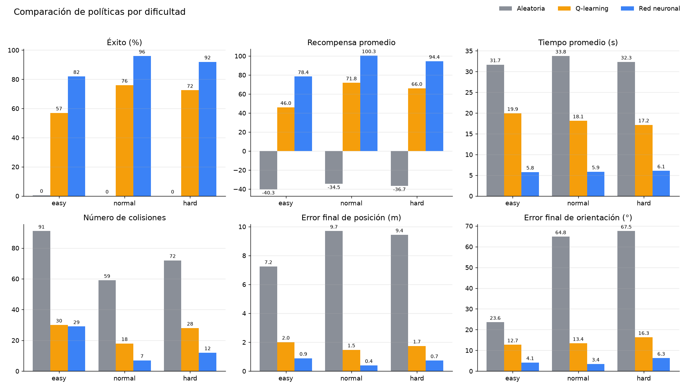
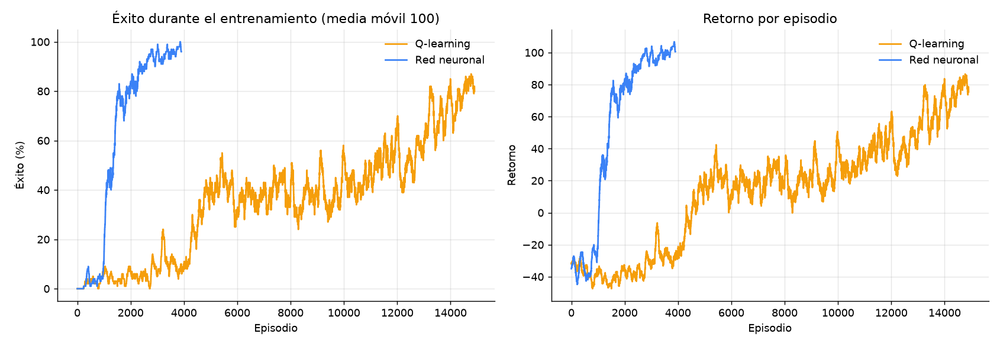

# AutoPark RL — Estacionamiento autónomo con aprendizaje por refuerzo

Un vehículo aprende a estacionarse en un cupo delimitado de un parqueadero, evitando
otros vehículos, conos, columnas y bordillos. El proyecto incluye:

- Un **ambiente Gymnasium** con física de bicicleta cinemática, sensores tipo LiDAR,
  colisiones exactas (SAT) y escenarios reproducibles con semillas.
- Dos agentes: **Q-learning tabular** y una **Deep Q-Network** escrita en NumPy puro.
- Una **visualización 3D en Three.js** conectada al ambiente Python por WebSocket.
- Un sistema de **evaluación** con gráficas comparativas y una batería de **pruebas**.



---

## Instalación

Requisitos: Python 3.12+ y un navegador moderno (la visualización carga Three.js desde CDN).

```bash
cd Parking
python3.12 -m venv .venv
```

Activar el entorno virtual:

```bash
# macOS / Linux
source .venv/bin/activate
# Windows (PowerShell)
.venv\Scripts\Activate.ps1
```

Instalar dependencias:

```bash
pip install -r requirements.txt
```

Todos los comandos siguientes asumen el entorno activado y el directorio `Parking/` como actual.

## Uso rápido

```bash
python run.py train --agent q_learning     # ~6 min, 15 000 episodios
python run.py train --agent neural         # ~3 min, 4 000 episodios
python run.py evaluate                     # tabla + gráficas en results/
python run.py serve                        # abre http://127.0.0.1:8000
```

### Ejecutar el ambiente

```bash
python run.py demo --agent random --episodes 3 --verbose
```

Uso directo desde Python:

```python
from parking_env import ParkingEnv

env = ParkingEnv(difficulty="normal", sensor_noise=0.0)
obs, info = env.reset(seed=42)
obs, reward, terminated, truncated, info = env.step(0)  # 0 = avanzar
```

### Entrenar cada agente

```bash
python run.py train --agent q_learning [--episodes 15000] [--difficulty normal] [--seed 0]
python run.py train --agent neural     [--episodes 4000]
python run.py train --agent neural --resume --episodes 1000   # continuar entrenando
```

Los modelos se guardan en `models/q_table.npz` y `models/dqn.npz`. El historial de
entrenamiento queda en `models/<agente>_history.json` y se usa para las curvas de aprendizaje.

### Evaluar

```bash
python run.py evaluate --episodes 200
# o directamente, con más opciones:
python evaluate.py --episodes 300 --difficulties normal hard --sensor-noise 0.1
```

Genera `results/metrics.json`, `results/comparison.png` y `results/training_curves.png`.
La evaluación usa semillas (desde 100 000) distintas a las de entrenamiento.

### Visualización 3D

```bash
python run.py serve [--port 8000] [--difficulty normal] [--sensor-noise 0.0]
```

Abrir **http://127.0.0.1:8000**. Si un agente no está entrenado, se puede entrenar desde la
misma interfaz y ver cómo mejora en vivo.

### Pruebas

```bash
python -m pytest
```

---

## Controles de la interfaz

La escena es un garaje techado en tonos lila: piso pulido con reflejos, luces lineales y letrero
de neón con *bloom*, ventanales con la ciudad al atardecer, columnas "P1" y jardineras.

| Control | Función |
|---|---|
| ▶ / ❚❚ (`Espacio`) | Inicia o pausa la política. Al terminar un episodio se reinicia solo. |
| ↻ (`R`) | Nuevo episodio: nuevo cupo objetivo, vehículos y conos. |
| 💡 Pista (`S` sensores, `T` trayectoria) | Muestra u oculta los rayos de los sensores y el rastro del vehículo. |
| 📷 (`C`) | Alterna cámara orbital (arrastrar para rotar), superior y de seguimiento. |
| Panel (`P`, botón inferior derecho) | Estado detallado, agente (Q-learning / red neuronal / aleatorio), velocidad 0.25×–10×, nivel, ruido en sensores, cámara y entrenamiento con progreso en vivo. |

La barra superior muestra el **nivel** (1 fácil, 2 normal, 3 difícil), el estado del episodio y
los **movimientos** (pasos). La barra inferior muestra agente, distancia al cupo, velocidad,
recompensa, episodio y choques.

Colores: morado = tu vehículo, verde = cupo objetivo / éxito, rojo = colisión, azul = sensores
(se tornan rojos cerca de un obstáculo). Los vehículos estacionados son deportivos de varios colores.

---|---|
| **Iniciar / Pausar** (`Espacio`) | Ejecuta la política paso a paso con animación interpolada. Al terminar un episodio se reinicia solo. |
| **Reiniciar** (`R`) | Nuevo episodio: nuevo cupo objetivo, vehículos y conos. |
| **Agente** | Q-learning, red neuronal o política aleatoria. Un punto ámbar indica "sin entrenar". |
| **Velocidad** | 0.25× a 10×. A 1× cada paso dura 0.2 s, igual que el `dt` del simulador. |
| **Dificultad** | Fácil (frente al cupo), normal (desde el pasillo), difícil (más conos en el camino). |
| **Sensores** (`S`) / **Trayectoria** (`T`) | Muestra u oculta los 8 rayos y el rastro del vehículo. |
| **Ruido** | Agrega ruido gaussiano (σ = 0.1 m) a los sensores. |
| **Cámara** (`C`) | Orbital (arrastrar para rotar, rueda para zoom), superior o seguimiento. |
| **Entrenar agente** | Entrena el agente seleccionado en segundo plano con barra de progreso, tasa de éxito y curva de retorno. |

Códigos de color: naranja = vehículo controlado, verde = cupo objetivo / éxito,
rojo = colisión, azul = sensores (se tornan rojos al acercarse a un obstáculo), gris = vehículos estacionados.

---

## Arquitectura

```
Parking/
├── parking_env.py        Ambiente Gymnasium (física, colisiones, sensores, recompensa)
├── agent_base.py         Interfaz Agent, epsilon-greedy y bucle de entrenamiento compartido
├── q_learning.py         Discretizador de estados + agente Q-learning tabular
├── neural_q_learning.py  MLP con Adam, memoria de experiencias y agente DQN
├── server.py             FastAPI: REST + WebSocket sobre una SimulationSession
├── evaluate.py           Comparación de políticas y gráficas (Matplotlib)
├── run.py                CLI: serve | train | demo | evaluate
├── tests/test_parking.py Pruebas automáticas (pytest)
└── web/                  index.html, styles.css, app.js (Three.js)
```

```
 Navegador (Three.js)                       Python
 ┌──────────────────────┐   WebSocket /ws   ┌──────────────────────────┐
 │ app.js               │ ────────────────▶ │ server.SimulationSession │
 │  · escena y modelos  │  {cmd, payload}   │  · ParkingEnv            │
 │  · interpolación     │ ◀──────────────── │  · agentes cargados      │
 │  · panel / controles │   estado JSON     │  · hilo de entrenamiento │
 └──────────────────────┘                   └──────────────────────────┘
```

**Comunicación.** El navegador dirige el ritmo: pide un paso (`step`), recibe el estado,
anima la transición durante `0.2 s / velocidad` y pide el siguiente. Así, pausar equivale a dejar
de pedir pasos y no hay estado de temporizadores en el servidor. REST y WebSocket pasan por el
mismo despachador (`SimulationSession.handle`), por lo que exponen exactamente los mismos comandos.

| Comando (WS `cmd`) | REST | Payload | Respuesta |
|---|---|---|---|
| `config` | `GET /api/config` | — | agentes, dificultades, acciones, modelos entrenados |
| `reset` | `POST /api/reset` | `seed?`, `difficulty?`, `sensor_noise?` | `layout` (cupos, obstáculos) + estado |
| `step` | `POST /api/step` | `action?` (0-4; si se omite actúa el agente) | estado |
| `state` | `GET /api/state` | — | estado |
| `agent` | `POST /api/agent` | `agent` | configuración |
| `train` | `POST /api/train` | `agent`, `episodes` | progreso del entrenamiento |

El **estado** contiene: posición `car.x/y`, rotación `car.heading`, `speed`, `steer`, `sensors`
(ángulo y distancia), `target`, `reward`, `total_reward`, `distance`, `heading_error`, `status`
(`running`, `success`, `collision`, `timeout`), episodio, contadores y progreso del entrenamiento.
Los errores de validación devuelven HTTP 400 o `{"type": "error", "message": ...}` por WebSocket.

Ejemplo controlando el vehículo manualmente por REST:

```bash
curl -X POST localhost:8000/api/reset -H 'Content-Type: application/json' -d '{"seed": 7}'
curl -X POST localhost:8000/api/step  -H 'Content-Type: application/json' -d '{"action": 0}'
```

---

## El problema de RL

### Escenario

Parqueadero de 30 × 20 m con dos filas de 8 cupos (3.0 × 5.5 m) y un pasillo central de 9 m.
En cada `reset` se elige un **cupo objetivo al azar** (16 posiciones posibles); los demás se
ocupan con probabilidad 0.6 (0.85 los vecinos inmediatos) con pequeñas variaciones de posición.
Hay columnas al final de cada fila y conos en el pasillo según la dificultad:

| Dificultad | Inicio | Conos |
|---|---|---|
| `easy` | Frente al cupo, apuntando hacia él (±17°) | 0 |
| `normal` | En el pasillo, 4–8 m a un lado del cupo | 2, fuera de la línea directa |
| `hard` | Igual que normal | 5, pueden bloquear el camino |

El vehículo (4.2 × 1.8 m, distancia entre ejes 2.6 m) sigue un **modelo de bicicleta cinemática**
con `dt = 0.2 s` y 2 subpasos para que no atraviese obstáculos delgados.

### Acciones (`Discrete(5)`)

| # | Acción | Efecto |
|---|---|---|
| 0 | Avanzar | +0.4 m/s (máx. 3 m/s) |
| 1 | Retroceder | −0.4 m/s (máx. −2 m/s) |
| 2 | Izquierda | dirección +0.15 rad (máx. 0.6 rad ≈ 34°) |
| 3 | Derecha | dirección −0.15 rad |
| 4 | Frenar | −1 m/s hacia 0 |

La dirección se mantiene entre pasos (como un volante) y la velocidad decae un 3 % por rodadura.

### Observación (`Box(14,)`, float32)

| Índice | Valor |
|---|---|
| 0–1 | Posición del cupo en el marco del vehículo (adelante, izquierda) / 10 m |
| 2 | Error de orientación respecto al cupo, plegado a ±90° (se acepta entrar de frente o en reversa) |
| 3 | Velocidad / 3 m/s |
| 4 | Ángulo de dirección / 0.6 rad |
| 5 | 1 si las cuatro esquinas están dentro del cupo |
| 6–13 | 8 sensores de distancia cada 45° (desde la carrocería) / 8 m |

La observación es **relativa al vehículo**, por lo que lo aprendido en un cupo sirve para todos.
Con `sensor_noise > 0` se agrega ruido gaussiano a los sensores y a la posición relativa.

### Recompensa

```
r = −0.05                                   penalización por tiempo
  + Φ(s') − Φ(s)                            acercamiento + alineación (shaping por potencial)
  − 0.3·|v|          si está dentro del cupo  incentivo para reducir la velocidad
  − 0.15             si está detenido fuera   evita políticas que se "congelan"
  − 50               si choca                 (termina el episodio)
  + 100              si se estaciona          (termina el episodio)

Φ(s) = −distancia − 1.5 · cercanía · |error de orientación|,   cercanía = max(0, 1 − d/6)
```

La alineación pesa más a medida que el vehículo se acerca, porque lejos del cupo orientarse
"bien" no tiene sentido.

### Terminación

- `terminated = True` si hay **colisión** (con un vehículo, cono, columna o el borde del
  parqueadero) o **éxito**: las cuatro esquinas dentro del cupo (holgura de 15 cm), error de
  orientación ≤ 0.25 rad (14°) y |v| ≤ 0.4 m/s.
- `truncated = True` a los 200 pasos (40 s simulados).
- `info`: `distance`, `heading_error`, `speed`, `steer`, `collision`, `success`, `in_slot`,
  `steps`, `target_id`.

---

## Los agentes

### A. Q-learning tabular (`q_learning.py`)

El estado continuo se discretiza en 9 × 9 × 7 × 4 × 5 × 2 × 2 = **45 360 estados**: posición
relativa (dx, dy) con celdas más finas cerca del cupo, error de orientación, velocidad
(reversa / detenido / lenta / rápida), dirección y dos bits de peligro (algún sensor delantero
o trasero a menos de 1 m). Actualización clásica:

```
Q(s,a) ← Q(s,a) + α [r + γ·max Q(s',·) − Q(s,a)]      α = 0.1, γ = 0.98
```

con exploración epsilon-greedy (ε de 1.0 a 0.05, decaimiento ×0.9995 por episodio).

### B. Deep Q-Network (`neural_q_learning.py`)

- Red 14 → 128 → 128 → 5 (ReLU), inicialización He, optimizador **Adam** con recorte de gradiente.
  Implementada en NumPy con *backprop* manual, verificada con gradiente numérico en las pruebas.
- **Memoria de experiencias** circular de 100 000 transiciones; lotes de 64 tras 1 000 pasos de calentamiento.
- **Red objetivo** sincronizada cada 1 000 pasos y **Double DQN** para reducir la sobreestimación.
- Pérdida de Huber y recompensas escaladas ×0.1 para estabilizar el entrenamiento.

### ¿Cuándo usar cada uno?

| | Q-learning tabular | DQN |
|---|---|---|
| Estado | Necesita discretizarlo a mano; la resolución es un compromiso | Usa la observación continua completa (los 8 sensores) |
| Generalización | Ninguna: cada celda se aprende por separado | Estados parecidos comparten valores |
| Muestras necesarias | Muchas (cada celda debe visitarse) | Menos, por la reutilización de la memoria |
| Costo por paso | Mínimo (una búsqueda en una tabla) | Mayor (un lote por paso) |
| Interpretabilidad | Alta: la tabla se puede inspeccionar | Baja |
| Estabilidad | Convergencia garantizada en el caso tabular | Requiere red objetivo, memoria y ajuste |

**Regla práctica:** Q-learning tabular para estados pequeños o fáciles de discretizar, para
enseñar o como línea base. DQN cuando el estado es continuo o de alta dimensión (sensores,
imágenes) y se necesita generalizar a situaciones no vistas, como en este parqueadero.

---

## Resultados

Entrenamiento en dificultad `normal` (Q-learning 15 000 episodios ≈ 6 min; DQN 4 000 episodios ≈ 3 min,
en un portátil) y evaluación voraz con 200 episodios por dificultad y semillas no vistas
(`python run.py evaluate`):

| Agente | Dificultad | Éxito | Colisiones | Recompensa | Tiempo | Error posición | Error orientación |
|---|---|---|---|---|---|---|---|
| Aleatoria | easy | 0 % | 91 | −40.3 | 31.7 s | 7.24 m | 23.6° |
| Aleatoria | normal | 0 % | 59 | −34.5 | 33.8 s | 9.69 m | 64.8° |
| Aleatoria | hard | 0 % | 72 | −36.7 | 32.3 s | 9.44 m | 67.5° |
| Q-learning | easy | 57 % | 22 | 46.6 | 21.6 s | 2.10 m | 12.9° |
| Q-learning | normal | 76 % | 19 | 71.7 | 17.8 s | 1.49 m | 13.4° |
| Q-learning | hard | 73 % | 28 | 66.5 | 17.0 s | 1.80 m | 16.0° |
| Red neuronal | easy | 82 % | 29 | 78.4 | 5.8 s | 0.89 m | 4.1° |
| **Red neuronal** | **normal** | **96 %** | **7** | **100.3** | **5.9 s** | **0.40 m** | **3.4°** |
| Red neuronal | hard | 92 % | 12 | 94.4 | 6.1 s | 0.73 m | 6.3° |



Observaciones:

- La **DQN** estaciona en ~6 s y generaliza a `hard` (conos en el camino) sin haberlo visto,
  gracias a que usa los 8 sensores continuos.
- El **Q-learning** aprende la tarea pero tarda 3× más y necesita casi 4× más episodios; su
  discretización solo "ve" dos bits de peligro, por lo que es más lento y menos preciso.
- Ambos rinden peor en `easy` que en `normal`: el inicio frente al cupo es una distribución de
  estados poco vista durante el entrenamiento. Entrenar con un currículo mixto lo corregiría.
- Una versión anterior de la recompensa (sin penalización por estar detenido) producía políticas
  que se quedaban quietas: 18–26 % de los episodios terminaban por tiempo agotado.

---

## Créditos

- Modelo 3D del superdeportivo (`web/models/sports_car.glb`): tomado de los ejemplos oficiales de
  [three.js](https://github.com/mrdoob/three.js/tree/dev/examples/models/gltf) (`ferrari.glb`),
  creado por **vicent091036** en Sketchfab ([modelo original](https://skfb.ly/6CQBT)), con licencia
  que exige atribución. Se recolorea en tiempo de ejecución y se le oscurecen los acentos de marca.
- [three.js](https://threejs.org) r160, cargado desde jsDelivr (incluye el decodificador Draco).

---

## Próximos pasos

- **Acciones continuas** (aceleración y dirección reales) con SAC o PPO, y maniobras en varios tiempos.
- **Currículo automático:** empezar en `easy` y aumentar la dificultad según la tasa de éxito.
- **Estacionamiento en paralelo y en diagonal**, y cupos con orientaciones arbitrarias.
- **Obstáculos dinámicos:** peatones y otros vehículos en movimiento.
- **Modelo dinámico** con derrape, latencia del actuador y ruido en el actuador.
- **Prioritized replay y Dueling DQN** para acelerar el aprendizaje.
- Grabar episodios desde la interfaz y reproducirlos.
